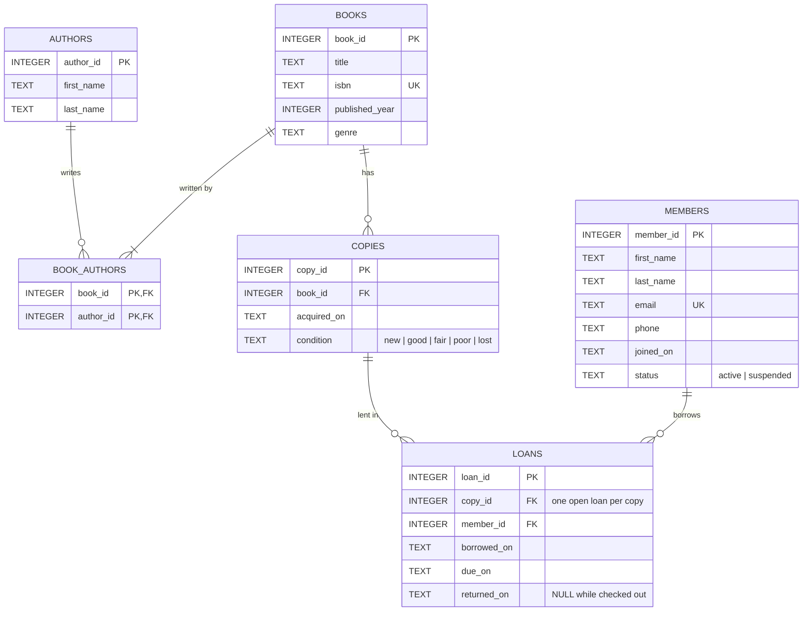

# Week 2 assignment: conversation transcript
Exported from a Claude Code session on 2026-10-22. Long tool outputs are shortened; internal planning calls are omitted.

---

## User

```
Create the folder ~/workspace/language-of-computation/week2-assignment and make it a git repository. Add a README.md that says this is my Module 2 assignment for MSAI-5523, and commit it to the main branch. Then create a public GitHub repository named week2-assignment and push the main branch to it.
```

**Ran:** Create folder, init git repo, check GitHub auth

```bash
mkdir -p ~/workspace/language-of-computation/week2-assignment && cd ~/workspace/language-of-computation/week2-assignment && ls -A && git init -b main && gh auth status 2>&1 | head -5
```

<details><summary>Output</summary>

```
Initialized empty Git repository in /Users/gilbertodiaz/workspace/language-of-computation/week2-assignment/.git/
github.com
  ✓ Logged in to github.com account redeemefy (keyring)
  - Active account: true
  - Git operations protocol: ssh
  - Token: gho_************************************
```

</details>

**Ran:** Write README, commit, check repo name is free

```bash
cd ~/workspace/language-of-computation/week2-assignment && cat > README.md <<'EOF'
# week2-assignment

This is my Module 2 assignment for MSAI-5523.
EOF
git add README.md && git commit -q -m "Add README for Module 2 assignment

Co-Authored-By: Claude Opus 5.5 <noreply@anthropic.com>" && git log --oneline && gh repo view redeemefy/week2-assignment 2>&1 | head -2
```

<details><summary>Output</summary>

```
a86894f Add README for Module 2 assignment
GraphQL: Could not resolve to a Repository with the name 'redeemefy/week2-assignment'. (repository)
```

</details>

**Ran:** Create public GitHub repo and push main

```bash
cd ~/workspace/language-of-computation/week2-assignment && gh repo create week2-assignment --public --source=. --remote=origin --push 2>&1 && git status -sb | head -1
```

<details><summary>Output</summary>

```
https://github.com/redeemefy/week2-assignment
To github.com:redeemefy/week2-assignment.git
 * [new branch]      HEAD -> main
branch 'main' set up to track 'origin/main'.
## main...origin/main
```

</details>

---

## User

[Request interrupted by user]

---

## User

make sure you use the lipscomb github credentian instead of my persona one

**Ran:** List GitHub accounts and SSH host aliases

```bash
gh auth status 2>&1; echo ---; cat ~/.ssh/config 2>/dev/null | grep -iE "^\s*(host|hostname|identityfile|user)\b"
```

<details><summary>Output</summary>

```
github.com
  ✓ Logged in to github.com account redeemefy (keyring)
  - Active account: true
  - Git operations protocol: ssh
  - Token: gho_************************************
  - Token scopes: 'admin:public_key', 'gist', 'read:org', 'repo'

  ✓ Logged in to github.com account gdiazcasanas (keyring)
  - Active account: false
  - Git operations protocol: ssh
  - Token: gho_************************************
  - Token scopes: 'gist', 'read:org', 'repo'
---
Host github.com
  HostName github.com
  User git
  IdentityFile ~/.ssh/id_ed25519
Host github-lipscomb
  HostName github.com
  User git
  IdentityFile ~/.ssh/id_ed25519_lipscomb
```

</details>

**Ran:** Confirm Lipscomb account identity and commit author

```bash
GH_TOKEN=$(gh auth token --user gdiazcasanas) gh api user --jq '{login,name,company,email}'; cd ~/workspace/language-of-computation/week2-assignment && git log -1 --format='%an <%ae>'; git config --global --get-regexp '^includeif' ; ssh -T git@github-lipscomb 2>&1 | head -1
```

<details><summary>Output</summary>

```
{"company":null,"email":null,"login":"gdiazcasanas","name":"Gilberto Díaz Casañas"}
Gilberto Diaz <me@gilbertodiaz.com>
includeif.gitdir:~/workspace/msai/.path ~/.config/git/config-lipscomb
Hi gdiazcasanas! You've successfully authenticated, but GitHub does not provide shell access.
```

</details>

**Ran:** Read Lipscomb git identity config

```bash
cat ~/.config/git/config-lipscomb
```

<details><summary>Output</summary>

```
# Identity for repos belonging to the Lipscomb GitHub account.
# Loaded by an [includeIf "gitdir:..."] block in ~/.gitconfig — do not include globally.

[user]
	name = Gilberto Diaz
	email = gdiazcasanas@lipscomb.edu
	signingkey = /Users/gilbertodiaz/.ssh/id_ed25519_lipscomb.pub

[core]
	# Force this key for every git network operation in matched directories,
	# regardless of what ssh-agent would otherwise offer first.
	sshCommand = ssh -i /Users/gilbertodiaz/.ssh/id_ed25519_lipscomb -o IdentitiesOnly=yes
```

</details>

**Ran:** Use Lipscomb identity, amend commit, create repo under Lipscomb account, push

```bash
cd ~/workspace/language-of-computation/week2-assignment && git config --local include.path ~/.config/git/config-lipscomb && git commit --amend --no-edit --reset-author -q && git log -1 --format='%h %an <%ae> sig:%G?' && GH_TOKEN=$(gh auth token --user gdiazcasanas) gh repo create week2-assignment --public 2>&1 && git remote set-url origin git@github.com:gdiazcasanas/week2-assignment.git && git push -u origin main 2>&1 && git status -sb | head -1
```

<details><summary>Output</summary>

```
40e10a8 Gilberto Diaz <gdiazcasanas@lipscomb.edu> sig:G
https://github.com/gdiazcasanas/week2-assignment
To github.com:gdiazcasanas/week2-assignment.git
 * [new branch]      main -> main
branch 'main' set up to track 'origin/main'.
## main...origin/main
```

</details>

> **Status:** The assignment now lives at github.com/gdiazcasanas/week2-assignment (public), pushed with your Lipscomb identity and SSH key. A leftover copy from the first push is still public at github.com/redeemefy/week2-assignment.
>
> **Question:** Delete the leftover repo on your personal account?

## Claude

I moved the repo to your Lipscomb account (gdiazcasanas): it's now at **https://github.com/gdiazcasanas/week2-assignment** and is public.

Your message arrived after I had already pushed once, so a copy is still public on your personal account at https://github.com/redeemefy/week2-assignment.

What changed in the local repo:
- **Commit identity:** This folder isn't under `~/workspace/msai/`, so your automatic Lipscomb git setup didn't apply and the first commit used your personal email. I set this repo to use `~/.config/git/config-lipscomb` and redid the commit. It's now by `gdiazcasanas@lipscomb.edu`, signed with your Lipscomb key, and pushes with that key.
- **GitHub account:** I created the repo using the gdiazcasanas login just for that one command. Your active `gh` account is still redeemefy.
- **Remote:** `origin` now points to `git@github.com:gdiazcasanas/week2-assignment.git`, and `main` tracks it.

I haven't deleted the personal copy, because deleting a repo can't be undone. To delete it, open the repo on GitHub and go to Settings → Delete this repository. Or run this, which first adds the delete permission your personal `gh` login doesn't have:

```bash
gh auth refresh -h github.com -s delete_repo
```

```bash
gh repo delete redeemefy/week2-assignment
```

Future assignment folders will have the same problem unless they're under `~/workspace/msai/`. To cover them, you could add a second rule to your global git config that applies the Lipscomb setup to `~/workspace/language-of-computation/`.

---

## User

use the parent folder as a prefix for the repo name

**Ran:** Rename GitHub repo, update remote, verify

```bash
cd ~/workspace/language-of-computation/week2-assignment && GH_TOKEN=$(gh auth token --user gdiazcasanas) gh repo rename language-of-computation-week2-assignment -R gdiazcasanas/week2-assignment --yes 2>&1 && git remote set-url origin git@github.com:gdiazcasanas/language-of-computation-week2-assignment.git && git fetch origin 2>&1 && git status -sb | head -1 && GH_TOKEN=$(gh auth token --user gdiazcasanas) gh repo view gdiazcasanas/language-of-computation-week2-assignment --json url,visibility
```

<details><summary>Error</summary>

```
Exit code 1
HTTP 422: Validation Failed (https://api.github.com/repos/gdiazcasanas/week2-assignment)
name already exists on this account
```

</details>

**Ran:** Inspect the existing repo with the target name

```bash
GH_TOKEN=$(gh auth token --user gdiazcasanas) gh repo view gdiazcasanas/language-of-computation-week2-assignment --json url,visibility,createdAt,pushedAt,description,defaultBranchRef 2>&1; GH_TOKEN=$(gh auth token --user gdiazcasanas) gh api repos/gdiazcasanas/language-of-computation-week2-assignment/commits --jq '.[] | "\(.sha[0:7]) \(.commit.author.date) \(.commit.message|split("\n")[0])"' 2>&1 | head; GH_TOKEN=$(gh auth token --user gdiazcasanas) gh api repos/gdiazcasanas/language-of-computation-week2-assignment/contents --jq '.[].path' 2>&1
```

<details><summary>Output</summary>

```
{"createdAt":"2026-10-16T16:02:22Z","defaultBranchRef":{"name":"main"},"description":"Language of Computation – Week 2: SQLite and server databases","pushedAt":"2026-10-16T16:02:26Z","url":"https://github.com/gdiazcasanas/language-of-computation-week2-assignment","visibility":"PRIVATE"}
ad2c837 2026-10-16T16:02:21Z Add README for SQLite and server databases assignment
README.md
```

</details>

> **Status:** I didn't rename the repo. A private repo named gdiazcasanas/language-of-computation-week2-assignment already exists, created Oct 16, and it holds a README for the SQLite and server databases assignment. Your new repo is still at gdiazcasanas/week2-assignment.
>
> **Question:** How should I handle the existing language-of-computation-week2-assignment repo?

## Claude

I couldn't rename the repo: GitHub refused because the name is already taken on your Lipscomb account. You already have a repo called **gdiazcasanas/language-of-computation-week2-assignment**:

- It's **private**, created Oct 16, 2026.
- Its description is "Language of Computation – Week 2: SQLite and server databases."
- It has one commit, a `README.md` for that assignment.

It looks like a repo you set up earlier for this same assignment. I haven't changed it, and your new repo is still at https://github.com/gdiazcasanas/week2-assignment. If I push into the existing repo, the two histories won't match, because each has its own README commit. I would merge them rather than force-push, so the README already there isn't overwritten.

---

## User

remove that private repo and this one is public

**Ran:** Delete the old private Lipscomb repo

```bash
GH_TOKEN=$(gh auth token --user gdiazcasanas) gh repo delete gdiazcasanas/language-of-computation-week2-assignment --yes 2>&1
```

<details><summary>Error</summary>

```
Exit code 1
HTTP 403: Must have admin rights to Repository. (https://api.github.com/repos/gdiazcasanas/language-of-computation-week2-assignment)
This API operation needs the "delete_repo" scope. To request it, run:  gh auth refresh -h github.com -s delete_repo
```

</details>

> **Status:** I couldn't delete the private language-of-computation-week2-assignment repo. Your Lipscomb gh login doesn't have the delete_repo permission, and adding it needs a browser sign-in only you can do. The public repo hasn't been renamed yet.
>
> **Question:** Let me know once the private repo is deleted or the permission is added.

## Claude

I couldn't delete the private repo `gdiazcasanas/language-of-computation-week2-assignment`. GitHub requires the `delete_repo` permission, which your Lipscomb `gh` login doesn't have. Adding it means signing in through the browser, which only you can do. Nothing has changed: the private repo still exists and the public one is still named `week2-assignment`.

You can do either of these:

**Option A: delete it on the web (simplest).** Open https://github.com/gdiazcasanas/language-of-computation-week2-assignment/settings, scroll to the bottom and click "Delete this repository."

**Option B: give `gh` the permission so I can delete it.** The refresh applies to the active account, so switch to the Lipscomb login first:

```bash
gh auth switch -u gdiazcasanas
```

```bash
gh auth refresh -h github.com -s delete_repo
```

```bash
gh auth switch -u redeemefy
```

Once the old repo is gone, I'll rename the public one to `language-of-computation-week2-assignment` and point your local `origin` at the new URL.

---

## User

I deleted the private repo myself. Go ahead and rename the public one.

**Ran:** Confirm old repo gone, rename public repo, update remote

```bash
cd ~/workspace/language-of-computation/week2-assignment && export GH_TOKEN=$(gh auth token --user gdiazcasanas) && gh repo view gdiazcasanas/language-of-computation-week2-assignment --json url 2>&1 | head -1; gh repo rename language-of-computation-week2-assignment -R gdiazcasanas/week2-assignment --yes 2>&1 && git remote set-url origin git@github.com:gdiazcasanas/language-of-computation-week2-assignment.git && git fetch origin 2>&1 && git status -sb | head -1 && git remote -v | head -1 && gh repo view gdiazcasanas/language-of-computation-week2-assignment --json url,visibility
```

<details><summary>Error</summary>

```
Exit code 1
{"url":"https://github.com/gdiazcasanas/language-of-computation-week2-assignment"}
HTTP 422: Validation Failed (https://api.github.com/repos/gdiazcasanas/week2-assignment)
name already exists on this account
```

</details>

**Ran:** Check whether the old private repo still exists

```bash
export GH_TOKEN=$(gh auth token --user gdiazcasanas) && gh repo view gdiazcasanas/language-of-computation-week2-assignment --json visibility,createdAt,pushedAt,description
```

<details><summary>Output</summary>

```
{"createdAt":"2026-10-16T16:02:22Z","description":"Language of Computation – Week 2: SQLite and server databases","pushedAt":"2026-10-16T16:02:26Z","visibility":"PRIVATE"}
```

</details>

> **Status:** The rename failed because the old private repo still exists on GitHub: it was created Oct 16 and is still private, with its README. The public repo is still named week2-assignment and nothing was changed.
>
> **Question:** Let me know once the private repo is actually gone.

## Claude

I couldn't do the rename. GitHub still has the private repo `gdiazcasanas/language-of-computation-week2-assignment`, so the name isn't free yet. It's the same one as before: created Oct 16, still private, description "Language of Computation – Week 2: SQLite and server databases."

The public repo is still `gdiazcasanas/week2-assignment` and nothing changed.

The delete probably didn't finish. Common causes:
- **The confirmation step wasn't completed.** GitHub makes you type the repo name and sometimes asks for your password or 2FA again. If you close the dialog at that point, nothing is deleted.
- **You deleted it while signed in as redeemefy.** If that account had access to the repo, the page would look the same. Check that the avatar in the top right is gdiazcasanas.
- **You deleted a different repo.**

Open https://github.com/gdiazcasanas/language-of-computation-week2-assignment while signed in as gdiazcasanas. If the page loads, the repo is still there. A 404 means it's gone, and then I'll rename the public repo and update your local `origin`.

---

## User

push again

**Ran:** Check status of both Lipscomb repos

```bash
export GH_TOKEN=$(gh auth token --user gdiazcasanas) && gh repo view gdiazcasanas/language-of-computation-week2-assignment --json visibility,createdAt 2>&1; gh repo view gdiazcasanas/week2-assignment --json visibility,url 2>&1
```

<details><summary>Output</summary>

```
GraphQL: Could not resolve to a Repository with the name 'gdiazcasanas/language-of-computation-week2-assignment'. (repository)
{"url":"https://github.com/gdiazcasanas/week2-assignment","visibility":"PUBLIC"}
```

</details>

## Claude

The old private repo is gone now. Renaming the public one and pushing.

**Ran:** Rename public repo, update remote, push main

```bash
cd ~/workspace/language-of-computation/week2-assignment && export GH_TOKEN=$(gh auth token --user gdiazcasanas) && gh repo rename language-of-computation-week2-assignment -R gdiazcasanas/week2-assignment --yes 2>&1 && git remote set-url origin git@github.com:gdiazcasanas/language-of-computation-week2-assignment.git && git push -u origin main 2>&1 && git fetch origin && git status -sb | head -1 && git remote get-url origin && gh repo view gdiazcasanas/language-of-computation-week2-assignment --json url,visibility
```

<details><summary>Output</summary>

```
Everything up-to-date
branch 'main' set up to track 'origin/main'.
## main...origin/main
git@github.com:gdiazcasanas/language-of-computation-week2-assignment.git
{"url":"https://github.com/gdiazcasanas/language-of-computation-week2-assignment","visibility":"PUBLIC"}
```

</details>

> **Status:** The public repo is now gdiazcasanas/language-of-computation-week2-assignment, and local main is pushed and in sync with it. The leftover copy on your personal account, redeemefy/week2-assignment, still exists.

## Claude

Your repo now has the prefixed name and is public: **https://github.com/gdiazcasanas/language-of-computation-week2-assignment**

- **The old private repo is gone.** That freed up the name, so the rename worked this time.
- **`origin` now points to the new URL.** I pushed `main` and Git reported "Everything up-to-date," because the commit was already on GitHub under the old name. Local `main` matches `origin/main`.
- **The commit is still under your Lipscomb identity.** It's authored by `gdiazcasanas@lipscomb.edu` and signed with your Lipscomb key.

The copy from my first push to your personal account is still there and public, at https://github.com/redeemefy/week2-assignment. Delete it on GitHub if you don't want it.

---

## User

```
Create a branch named assignment and switch to it. Then check whether I can create a SQLite database on this computer, and set it up if I can't.
```

**Ran:** Create branch and check for SQLite

```bash
cd ~/workspace/language-of-computation/week2-assignment && git switch -c assignment && git branch --show-current; echo ---; which -a sqlite3; sqlite3 --version; python3 -c "import sqlite3; print('python sqlite', sqlite3.sqlite_version)"; brew list sqlite 2>/dev/null | head -1
```

<details><summary>Output</summary>

```
Switched to a new branch 'assignment'
assignment
---
/usr/bin/sqlite3
3.51.0 2025-06-12 13:14:41 f0ca7bba1c5e232e5d279fad6338121ab55af0c8c68c84cdfb18ba5114dcaapl (64-bit)
python sqlite 3.53.1
/opt/homebrew/Cellar/sqlite/3.53.4/INSTALL_RECEIPT.json
```

</details>

## Claude

SQLite is already installed. Now I'll check that a database can actually be created and written to, using a throwaway file in the scratchpad.

**Ran:** Create, write, and read a test SQLite database

```bash
D=/private/tmp/claude-501/-Users-gilbertodiaz-workspace-language-of-computation-week2-assignment/a1d894df-4b8d-4cea-b045-51581feedb4f/scratchpad; mkdir -p $D && rm -f $D/test.db && sqlite3 $D/test.db "CREATE TABLE t(id INTEGER PRIMARY KEY, name TEXT); INSERT INTO t(name) VALUES ('hello'); SELECT * FROM t;" && ls -l $D/test.db && rm $D/test.db; echo; /opt/homebrew/opt/sqlite/bin/sqlite3 --version; echo $PATH | tr : '\n' | grep -n -E 'homebrew|/usr/bin$'
```

<details><summary>Output</summary>

```
1|hello
-rw-r--r--@ 1 gilbertodiaz  wheel  8192 Oct 22 18:36 /private/tmp/claude-501/-Users-gilbertodiaz-workspace-language-of-computation-week2-assignment/a1d894df-4b8d-4cea-b045-51581feedb4f/scratchpad/test.db

3.53.4 2026-07-24 19:02:57 bf7c7f30031888f4e796e429ab3978879485813aaca6f641c7b33e4e09459bcc (64-bit)
3:/opt/homebrew/opt/libpq/bin
7:/System/Cryptexes/App/usr/bin
8:/usr/bin
13:/var/run/com.apple.security.cryptexd/codex.system/bootstrap/usr/bin
16:/opt/homebrew/bin
```

</details>

> **Status:** You're on a new local branch, assignment, which isn't pushed yet. SQLite already works on this Mac: I created, wrote to and read from a test database, then deleted it. Nothing needed installing.

## Claude

You're on a new branch called `assignment` (local only, not pushed yet). You can already create SQLite databases on this computer, so I didn't install anything.

**Check:** I made a test database, created a table, added a row and read it back (`1|hello`). Then I deleted the test file.

**What you have:**
- **`sqlite3` at `/usr/bin/sqlite3`, version 3.51.0.** This is the copy that comes with macOS, and it's what you get when you type `sqlite3`.
- **A Homebrew copy, version 3.53.4.** It's installed but not used by default: Homebrew only installs it at `/opt/homebrew/opt/sqlite/bin/sqlite3`, not on your PATH.
- **Python's `sqlite3` module, SQLite 3.53.1.** This works too if your assignment uses Python.

The macOS version is fine for coursework. If you'd rather use the newer Homebrew version by default, add it to the front of your PATH in `~/.zshrc`:

```bash
echo 'export PATH="/opt/homebrew/opt/sqlite/bin:$PATH"' >> ~/.zshrc
```

To create a database for your assignment, run this from the repo folder. It opens `assignment.db`, which is saved once you create a table:

```bash
sqlite3 assignment.db
```

---

## User

I want to build a database to manage a library that people can borrow books.

**Wrote** `schema.sql`

```sql
-- Library lending database schema (SQLite)
--
-- A book is a title (e.g. "Dune"). The library can own several physical
-- copies of the same book, and members borrow copies, not books.

PRAGMA foreign_keys = ON;

DROP VIEW IF EXISTS overdue_loans;
DROP VIEW IF EXISTS book_availability;
DROP TABLE IF EXISTS loans;
DROP TABLE IF EXISTS copies;
DROP TABLE IF EXISTS book_authors;
DROP TABLE IF EXISTS books;
DROP TABLE IF EXISTS authors;
DROP TABLE IF EXISTS members;

CREATE TABLE authors (
    author_id   INTEGER PRIMARY KEY,
    first_name  TEXT NOT NULL,
    last_name   TEXT NOT NULL
) STRICT;

CREATE TABLE books (
    book_id         INTEGER PRIMARY KEY,
    title           TEXT NOT NULL,
    isbn            TEXT UNIQUE,
    published_year  INTEGER,
    genre           TEXT
) STRICT;

-- A book can have several authors and an author can write several books.
CREATE TABLE book_authors (
    book_id    INTEGER NOT NULL REFERENCES books(book_id) ON DELETE CASCADE,
    author_id  INTEGER NOT NULL REFERENCES authors(author_id) ON DELETE CASCADE,
    PRIMARY KEY (book_id, author_id)
) STRICT;

-- Physical copies on the shelf.
CREATE TABLE copies (
    copy_id      INTEGER PRIMARY KEY,
    book_id      INTEGER NOT NULL REFERENCES books(book_id),
    acquired_on  TEXT NOT NULL DEFAULT (date('now')),
    condition    TEXT NOT NULL DEFAULT 'good'
                 CHECK (condition IN ('new', 'good', 'fair', 'poor', 'lost'))
) STRICT;

CREATE TABLE members (
    member_id   INTEGER PRIMARY KEY,
    first_name  TEXT NOT NULL,
    last_name   TEXT NOT NULL,
    email       TEXT NOT NULL UNIQUE,
    phone       TEXT,
    joined_on   TEXT NOT NULL DEFAULT (date('now')),
    status      TEXT NOT NULL DEFAULT 'active'
                CHECK (status IN ('active', 'suspended'))
) STRICT;

-- One row per borrowing. returned_on stays NULL until the copy comes back.
CREATE TABLE loans (
    loan_id      INTEGER PRIMARY KEY,
... (45 more lines)
```

<details><summary>Output</summary>

```
File created successfully at: /Users/gilbertodiaz/workspace/language-of-computation/week2-assignment/schema.sql (file state is current in your context — no need to Read it back)
```

</details>

**Wrote** `seed.sql`

```sql
-- Sample data for the library database.
-- Members are made up. Loan dates are set around October 2026.

PRAGMA foreign_keys = ON;

INSERT INTO authors (author_id, first_name, last_name) VALUES
    (1, 'Frank',   'Herbert'),
    (2, 'Octavia', 'Butler'),
    (3, 'Ursula',  'Le Guin'),
    (4, 'Harold',  'Abelson'),
    (5, 'Gerald',  'Sussman'),
    (6, 'Toni',    'Morrison'),
    (7, 'Gabriel', 'García Márquez');

INSERT INTO books (book_id, title, isbn, published_year, genre) VALUES
    (1, 'Dune',                                            '9780441172719', 1965, 'Science Fiction'),
    (2, 'Kindred',                                         '9780807083697', 1979, 'Science Fiction'),
    (3, 'The Left Hand of Darkness',                       '9780441478125', 1969, 'Science Fiction'),
    (4, 'Structure and Interpretation of Computer Programs','9780262510875', 1985, 'Computer Science'),
    (5, 'Beloved',                                         '9781400033416', 1987, 'Literary Fiction'),
    (6, 'One Hundred Years of Solitude',                   '9780060883287', 1967, 'Literary Fiction'),
    (7, 'Parable of the Sower',                            '9781538732182', 1993, 'Science Fiction');

INSERT INTO book_authors (book_id, author_id) VALUES
    (1, 1),
    (2, 2),
    (3, 3),
    (4, 4), (4, 5),
    (5, 6),
    (6, 7),
    (7, 2);

INSERT INTO copies (copy_id, book_id, acquired_on, condition) VALUES
    (1,  1, '2024-01-10', 'good'),
    (2,  1, '2024-01-10', 'fair'),
    (3,  1, '2026-03-02', 'new'),
    (4,  2, '2024-05-21', 'good'),
    (5,  3, '2023-11-04', 'poor'),
    (6,  3, '2025-02-14', 'good'),
    (7,  4, '2022-08-30', 'fair'),
    (8,  5, '2024-09-12', 'good'),
    (9,  6, '2023-06-01', 'good'),
    (10, 6, '2023-06-01', 'lost'),
    (11, 7, '2026-01-20', 'new');

INSERT INTO members (member_id, first_name, last_name, email, phone, joined_on, status) VALUES
    (1, 'Ana',     'Rivera',  'ana.rivera@example.com',   '615-555-0101', '2024-02-01', 'active'),
    (2, 'Marcus',  'Lee',     'marcus.lee@example.com',   '615-555-0102', '2024-06-15', 'active'),
    (3, 'Priya',   'Shah',    'priya.shah@example.com',   NULL,           '2025-01-08', 'active'),
    (4, 'Daniel',  'Okafor',  'daniel.okafor@example.com','615-555-0104', '2025-09-30', 'suspended'),
    (5, 'Sofia',   'Novak',   'sofia.novak@example.com',  '615-555-0105', '2026-04-11', 'active');

INSERT INTO loans (loan_id, copy_id, member_id, borrowed_on, due_on, returned_on) VALUES
    -- Returned loans (history)
    (1,  1, 1, '2026-08-01', '2026-08-15', '2026-08-12'),
    (2,  4, 2, '2026-08-05', '2026-08-19', '2026-08-25'),
    (3,  7, 3, '2026-09-01', '2026-09-15', '2026-09-14'),
    (4,  1, 5, '2026-09-10', '2026-09-24', '2026-09-20'),
    -- Still out, due date not passed yet
    (5,  3, 1, '2026-10-15', '2026-10-29', NULL),
... (5 more lines)
```

<details><summary>Output</summary>

```
File created successfully at: /Users/gilbertodiaz/workspace/language-of-computation/week2-assignment/seed.sql (file state is current in your context — no need to Read it back)
```

</details>

**Wrote** `queries.sql`

```sql
-- Everyday library queries. Run with:  sqlite3 library.db < queries.sql

.headers on
.mode column
PRAGMA foreign_keys = ON;

-- 1. Catalog: every book with its authors and how many copies are available.
SELECT a.title,
       group_concat(au.first_name || ' ' || au.last_name, ', ') AS authors,
       a.available_copies,
       a.total_copies
FROM book_availability a
JOIN book_authors ba ON ba.book_id = a.book_id
JOIN authors au      ON au.author_id = ba.author_id
GROUP BY a.book_id
ORDER BY a.title;

-- 2. Copies of "Dune" that are on the shelf right now.
SELECT c.copy_id, c.condition
FROM copies c
JOIN books b ON b.book_id = c.book_id
WHERE b.title = 'Dune'
  AND c.condition <> 'lost'
  AND NOT EXISTS (SELECT 1 FROM loans l
                  WHERE l.copy_id = c.copy_id AND l.returned_on IS NULL);

-- 3. What a member (Ana Rivera, member 1) currently has checked out.
SELECT b.title, l.copy_id, l.borrowed_on, l.due_on
FROM loans l
JOIN copies c ON c.copy_id = l.copy_id
JOIN books b  ON b.book_id = c.book_id
WHERE l.member_id = 1 AND l.returned_on IS NULL;

-- 4. Overdue loans, worst first.
SELECT * FROM overdue_loans ORDER BY days_overdue DESC;

-- 5. Most borrowed books of all time.
SELECT b.title, COUNT(*) AS times_borrowed
FROM loans l
JOIN copies c ON c.copy_id = l.copy_id
JOIN books b  ON b.book_id = c.book_id
GROUP BY b.book_id
ORDER BY times_borrowed DESC, b.title;

-- 6. Borrow: member 2 checks out copy 2 for 14 days.
--    Only inserts if the member is active and the copy is on the shelf.
INSERT INTO loans (copy_id, member_id)
SELECT 2, 2
WHERE EXISTS (SELECT 1 FROM members WHERE member_id = 2 AND status = 'active')
  AND EXISTS (SELECT 1 FROM copies  WHERE copy_id = 2 AND condition <> 'lost')
  AND NOT EXISTS (SELECT 1 FROM loans WHERE copy_id = 2 AND returned_on IS NULL);
SELECT changes() AS loans_created;

-- 7. Return: copy 2 comes back today.
UPDATE loans
SET returned_on = date('now')
WHERE copy_id = 2 AND returned_on IS NULL;
SELECT changes() AS loans_closed;
```

<details><summary>Output</summary>

```
File created successfully at: /Users/gilbertodiaz/workspace/language-of-computation/week2-assignment/queries.sql (file state is current in your context — no need to Read it back)
```

</details>

**Ran:** Build database, run queries, test constraints

```bash
cd ~/workspace/language-of-computation/week2-assignment && rm -f library.db && sqlite3 -bail library.db < schema.sql && sqlite3 -bail library.db < seed.sql && sqlite3 -bail library.db < queries.sql; echo "=== constraint tests"; for q in \
 "INSERT INTO loans(copy_id,member_id) VALUES (3,2);" \
 "INSERT INTO loans(copy_id,member_id) VALUES (99,1);" \
 "INSERT INTO loans(copy_id,member_id,borrowed_on,due_on) VALUES (9,1,'2026-10-10','2026-10-01');" \
 "INSERT INTO members(first_name,last_name,email) VALUES ('X','Y','ana.rivera@example.com');" \
 "INSERT INTO copies(book_id,condition) VALUES (1,'shiny');" \
 "INSERT INTO books(title,published_year) VALUES ('Z','nineteen');" ; do echo "-- $q"; sqlite3 library.db "PRAGMA foreign_keys=ON; $q" 2>&1; done; sqlite3 library.db "PRAGMA foreign_key_check; PRAGMA integrity_check; SELECT count(*) FROM loans;"
```

<details><summary>Output</summary>

```
title                                              authors                         available_copies  total_copies
-------------------------------------------------  ------------------------------  ----------------  ------------
Beloved                                            Toni Morrison                   0                 1           
Dune                                               Frank Herbert                   2                 3           
Kindred                                            Octavia Butler                  0                 1           
One Hundred Years of Solitude                      Gabriel García Márquez          1                 1           
Parable of the Sower                               Octavia Butler                  0                 1           
Structure and Interpretation of Computer Programs  Harold Abelson, Gerald Sussman  1                 1           
The Left Hand of Darkness                          Ursula Le Guin                  1                 2           
copy_id  condition
-------  ---------
1        good     
2        fair     
title  copy_id  borrowed_on  due_on    
-----  -------  -----------  ----------
Dune   3        2026-10-15   2026-10-29
loan_id  member         email                      title                      copy_id  due_on      days_overdue
-------  -------------  -------------------------  -------------------------  -------  ----------  ------------
9        Daniel Okafor  daniel.okafor@example.com  The Left Hand of Darkness  6        2026-10-04  18          
8        Marcus Lee     marcus.lee@example.com     Kindred                    4        2026-10-09  13          
title                                              times_borrowed
-------------------------------------------------  --------------
Dune                                               3             
Kindred                                            2             
Beloved                                            1             
Parable of the Sower                               1             
Structure and Interpretation of Computer Programs  1             
The Left Hand of Darkness                          1             
loans_created
-------------
1            
loans_closed
------------
1           
=== constraint tests
-- INSERT INTO loans(copy_id,member_id) VALUES (3,2);
Error: stepping, UNIQUE constraint failed: loans.copy_id (19)
-- INSERT INTO loans(copy_id,member_id) VALUES (99,1);
Error: stepping, FOREIGN KEY constraint failed (19)
-- INSERT INTO loans(copy_id,member_id,borrowed_on,due_on) VALUES (9,1,'2026-10-10','2026-10-01');
Error: stepping, CHECK constraint failed: due_on >= borrowed_on (19)
-- INSERT INTO members(first_name,last_name,email) VALUES ('X','Y','ana.rivera@example.com');
Error: stepping, UNIQUE constraint failed: members.email (19)
-- INSERT INTO copies(book_id,condition) VALUES (1,'shiny');
Error: stepping, CHECK constraint failed: condition IN ('new', 'good', 'fair', 'poor', 'lost') (19)
-- INSERT INTO books(title,published_year) VALUES ('Z','nineteen');
Error: stepping, cannot store TEXT value in INTEGER column books.published_year (19)
ok
10
```

</details>

**Ran:** Rebuild clean database and document usage in README

````bash
cd ~/workspace/language-of-computation/week2-assignment && rm -f library.db && sqlite3 -bail library.db < schema.sql && sqlite3 -bail library.db < seed.sql && sqlite3 library.db "SELECT count(*) FROM loans;" && cat >> README.md <<'EOF'

## Library database

A SQLite database for a lending library: books, authors, physical copies, members and loans.

- `schema.sql` creates the tables, constraints and views (`book_availability`, `overdue_loans`).
- `seed.sql` loads sample data.
- `queries.sql` shows common tasks: searching the catalog, checking availability, borrowing, returning and listing overdue loans.

Build the database:

```bash
sqlite3 library.db < schema.sql
sqlite3 library.db < seed.sql
```

Run the example queries (they borrow and return a copy, so they change the data):

```bash
sqlite3 library.db < queries.sql
```
EOF
git status -s
````

<details><summary>Output</summary>

```
9
 M README.md
?? library.db
?? queries.sql
?? schema.sql
?? seed.sql
```

</details>

> **Status:** The library database is built on the assignment branch: a schema, sample data, example queries and a rebuilt library.db, all tested. Nothing is committed yet.
>
> **Question:** Commit these files to the assignment branch and push?

## Claude

I built the library database and tested it. It's in `library.db`, and the SQL files that create it are in the repo on the `assignment` branch.

**How it's set up** ([schema.sql](schema.sql))

The database separates a book title from the physical copies on the shelf, because members borrow a specific copy and the library can own several copies of one title.

| Table | What it stores |
|---|---|
| `books` | Titles, with ISBN, year and genre |
| `authors` and `book_authors` | Authors, with support for books that have more than one author |
| `copies` | Each physical copy and its condition (new / good / fair / poor / lost) |
| `members` | Borrowers, with a unique email and a status (active or suspended) |
| `loans` | Each borrowing: who, which copy, when it was borrowed, when it's due and when it came back (empty while still out) |

It also has two views:
- **`book_availability`:** how many copies of each title exist and how many are on the shelf now.
- **`overdue_loans`:** loans that are past due and not returned.

**What the database refuses**
- Lending a copy that's already checked out.
- Loans for copies or members that don't exist.
- A due date before the borrow date.
- Two members with the same email.
- An unknown condition, or text in a number column.

I tried each of these and got the expected error every time.

**Sample data and queries**
- [seed.sql](seed.sql) adds 7 books, 11 copies, 5 made-up members and 9 loans. Two of those loans are overdue as of today.
- [queries.sql](queries.sql) covers searching the catalog, finding available copies, seeing what a member has out, listing overdue loans, most-borrowed books, borrowing and returning.
- The borrow step only adds a loan if the member is active and the copy is on the shelf.

I also added build instructions to [README.md](README.md).

**Two things to know**
- **Overdue counts change over time.** The view compares against today's date, so the sample loans that aren't due yet will show as overdue after early November.
- **`queries.sql` changes the data.** It borrows and returns a copy, so running it adds a loan. To start fresh, run `schema.sql` and then `seed.sql` again.

---

## User

can you show me the ERD using Mermaid and open the image for me to look at it

**Ran:** Check for Mermaid CLI and Node

```bash
which mmdc npx node; ls ~/.npm/_npx 2>/dev/null | head -3
```

<details><summary>Output</summary>

```
mmdc not found
/Users/gilbertodiaz/.local/share/mise/installs/node/26/bin/npx
/Users/gilbertodiaz/.local/share/mise/installs/node/26/bin/node
69f9afb961c37556
7b1d68f041a84c52
b388654678d519d9
```

</details>

**Wrote** `erd.mmd`



<details><summary>Output</summary>

```
File created successfully at: /Users/gilbertodiaz/workspace/language-of-computation/week2-assignment/erd.mmd (file state is current in your context — no need to Read it back)
```

</details>

**Used tool** `SendUserFile`

```json
{
  "files": [
    "/Users/gilbertodiaz/workspace/language-of-computation/week2-assignment/erd.mmd"
  ],
  "caption": "Library database ERD",
  "display": "render",
  "status": "normal"
}
```

<details><summary>Output</summary>

```
1 file delivered to user.
```

</details>

> **Status:** I added erd.mmd, a Mermaid ERD of the library schema, and opened it in the side panel. Nothing is committed yet. I haven't exported it as a PNG or SVG, because that needs the Mermaid CLI, which isn't installed.
>
> **Question:** Export the ERD as a PNG image too?

## Claude

The ERD is open in the side panel. I saved the Mermaid source as [erd.mmd](erd.mmd).

How the tables relate:
- **Books and authors:** each book has one or more authors, and each author can write many books. `book_authors` connects them.
- **Books and copies:** a book can have any number of physical copies, including none.
- **Copies and loans:** a copy can appear in many loans over time, but only one can be open at once (shown as a note on `copy_id`).
- **Members and loans:** a member can have many loans.

Each table lists its columns with their type and whether they are a primary key (PK), foreign key (FK) or unique (UK). Notes show the allowed values for `condition` and `status`, and that `returned_on` stays empty while a book is checked out.

The panel draws the diagram straight from the `.mmd` file, so I haven't made a separate image file. GitHub also draws Mermaid when it's in a ` ```mermaid ` block in a Markdown file, so you could paste it into the README.

---

## User

Export the ERD to erd.png using the Mermaid CLI via npx.

**Ran:** Render the ERD to PNG with Mermaid CLI

```bash
cd ~/workspace/language-of-computation/week2-assignment && npx -y @mermaid-js/mermaid-cli@11 -i erd.mmd -o erd.png -b white -s 2 2>&1 | tail -15; ls -l erd.png
```

<details><summary>Output</summary>

```
Generating single mermaid chart
-rw-r--r--@ 1 gilbertodiaz  staff  115566 Oct 22 18:42 erd.png
```

</details>

**Used tool** `Read`

```json
{
  "file_path": "/Users/gilbertodiaz/workspace/language-of-computation/week2-assignment/erd.png"
}
```

<details><summary>Output</summary>

```
[image]
```

</details>

**Used tool** `SendUserFile`

```json
{
  "files": [
    "/Users/gilbertodiaz/workspace/language-of-computation/week2-assignment/erd.png"
  ],
  "caption": "Library database ERD (erd.png)",
  "display": "render",
  "status": "normal"
}
```

<details><summary>Output</summary>

```
1 file delivered to user.
```

</details>

> **Status:** erd.png is exported from erd.mmd and open in the side panel. It shows all six tables and their relationships correctly. Nothing is committed yet.
>
> **Question:** Commit everything to the assignment branch and push?

## Claude

I exported the diagram to [erd.png](erd.png) and opened it in the side panel. I used Mermaid CLI v11 through `npx`, with a white background and 2× scale so it stays sharp in a document or slide.

I looked over the image and it's correct:
- All six tables are there with their columns and keys.
- The lines between them match the database design, including the one-to-many and many-to-many links.
- The notes for allowed values, the one-open-loan-per-copy rule and the empty `returned_on` are on the right columns.

If you change [erd.mmd](erd.mmd), run this to redraw the image:

```bash
npx -y @mermaid-js/mermaid-cli@11 -i erd.mmd -o erd.png -b white -s 2
```

---

## User

I want all dates in all tables in with the date type

**Ran:** Change date columns to DATE in schema and ERD

```bash
cd ~/workspace/language-of-computation/week2-assignment && python3 - <<'EOF'
import re
p='schema.sql'; s=open(p).read()
s=s.replace("""-- Library lending database schema (SQLite)
--
-- A book is a title (e.g. "Dune"). The library can own several physical
-- copies of the same book, and members borrow copies, not books.
""","""-- Library lending database schema (SQLite)
--
-- A book is a title (e.g. "Dune"). The library can own several physical
-- copies of the same book, and members borrow copies, not books.
--
-- Date columns are declared DATE. SQLite has no real date type and STRICT
-- tables only accept INTEGER/REAL/TEXT/BLOB/ANY, so tables with dates are
-- not STRICT. Dates are stored as 'YYYY-MM-DD' text, and a CHECK on each
-- one rejects anything that isn't a valid date in that format.
""")
s=s.replace("""    acquired_on  TEXT NOT NULL DEFAULT (date('now')),
    condition    TEXT NOT NULL DEFAULT 'good'
                 CHECK (condition IN ('new', 'good', 'fair', 'poor', 'lost'))
) STRICT;""","""    acquired_on  DATE NOT NULL DEFAULT (date('now'))
                 CHECK (date(acquired_on) IS acquired_on),
    condition    TEXT NOT NULL DEFAULT 'good'
                 CHECK (condition IN ('new', 'good', 'fair', 'poor', 'lost'))
);""")
s=s.replace("""    joined_on   TEXT NOT NULL DEFAULT (date('now')),
    status      TEXT NOT NULL DEFAULT 'active'
                CHECK (status IN ('active', 'suspended'))
) STRICT;""","""    joined_on   DATE NOT NULL DEFAULT (date('now'))
                CHECK (date(joined_on) IS joined_on),
    status      TEXT NOT NULL DEFAULT 'active'
                CHECK (status IN ('active', 'suspended'))
);""")
s=s.replace("""    borrowed_on  TEXT NOT NULL DEFAULT (date('now')),
    due_on       TEXT NOT NULL DEFAULT (date('now', '+14 days')),
    returned_on  TEXT,
    CHECK (due_on >= borrowed_on),
    CHECK (returned_on IS NULL OR returned_on >= borrowed_on)
) STRICT;""","""    borrowed_on  DATE NOT NULL DEFAULT (date('now'))
                 CHECK (date(borrowed_on) IS borrowed_on),
    due_on       DATE NOT NULL DEFAULT (date('now', '+14 days'))
                 CHECK (date(due_on) IS due_on),
    returned_on  DATE
                 CHECK (returned_on IS NULL OR date(returned_on) IS returned_on),
    CHECK (due_on >= borrowed_on),
    CHECK (returned_on IS NULL OR returned_on >= borrowed_on)
);""")
open(p,'w').write(s)
e='erd.mmd'; t=open(e).read()
for c in ['acquired_on','joined_on','borrowed_on','due_on','returned_on']:
    t=t.replace(f"TEXT {c}",f"DATE {c}")
open(e,'w').write(t)
EOF
grep -n "DATE\|STRICT" schema.sql erd.mmd
```

<details><summary>Output</summary>

```
erd.mmd:27:        DATE acquired_on
erd.mmd:36:        DATE joined_on
erd.mmd:43:        DATE borrowed_on
erd.mmd:44:        DATE due_on
erd.mmd:45:        DATE returned_on "NULL while checked out"
schema.sql:6:-- Date columns are declared DATE. SQLite has no real date type and STRICT
schema.sql:8:-- not STRICT. Dates are stored as 'YYYY-MM-DD' text, and a CHECK on each
schema.sql:26:) STRICT;
schema.sql:34:) STRICT;
schema.sql:41:) STRICT;
schema.sql:47:    acquired_on  DATE NOT NULL DEFAULT (date('now'))
schema.sql:59:    joined_on   DATE NOT NULL DEFAULT (date('now'))
schema.sql:70:    borrowed_on  DATE NOT NULL DEFAULT (date('now'))
schema.sql:72:    due_on       DATE NOT NULL DEFAULT (date('now', '+14 days'))
schema.sql:74:    returned_on  DATE
```

</details>

**Ran:** Rebuild database and test date validation

```bash
cd ~/workspace/language-of-computation/week2-assignment && rm -f library.db && sqlite3 -bail library.db < schema.sql && sqlite3 -bail library.db < seed.sql && sqlite3 library.db "SELECT name, type FROM pragma_table_info('loans') WHERE name LIKE '%_on'; SELECT count(*) loans, (SELECT count(*) FROM overdue_loans) overdue FROM loans; SELECT typeof(due_on) FROM loans LIMIT 1;" && echo "=== tests" && for q in \
 "INSERT INTO members(first_name,last_name,email,joined_on) VALUES ('X','Y','x1@example.com','2026-02-30');" \
 "INSERT INTO members(first_name,last_name,email,joined_on) VALUES ('X','Y','x2@example.com','10/22/2026');" \
 "INSERT INTO copies(book_id,acquired_on) VALUES (1,20261022);" \
 "UPDATE loans SET returned_on='yesterday' WHERE loan_id=5;" \
 "INSERT INTO loans(copy_id,member_id,borrowed_on,due_on) VALUES (2,1,'2026-10-10','2026-10-01');" \
 "INSERT INTO members(first_name,last_name,email) VALUES ('Ok','Default','ok@example.com'); SELECT joined_on FROM members WHERE email='ok@example.com';" \
 "INSERT INTO books(title,published_year) VALUES ('Z','nineteen');" ; do echo "-- $q"; sqlite3 library.db "PRAGMA foreign_keys=ON; $q" 2>&1; done; cp library.db /private/tmp/claude-501/-Users-gilbertodiaz-workspace-language-of-computation-week2-assignment/a1d894df-4b8d-4cea-b045-51581feedb4f/scratchpad/q.db && sqlite3 -bail /private/tmp/claude-501/-Users-gilbertodiaz-workspace-language-of-computation-week2-assignment/a1d894df-4b8d-4cea-b045-51581feedb4f/scratchpad/q.db < queries.sql > /dev/null && echo queries.sql OK; rm -f library.db && sqlite3 -bail library.db < schema.sql && sqlite3 -bail library.db < seed.sql && sqlite3 library.db "PRAGMA integrity_check; SELECT count(*) FROM members;"
```

<details><summary>Output</summary>

```
borrowed_on|DATE
due_on|DATE
returned_on|DATE
9|2
text
=== tests
-- INSERT INTO members(first_name,last_name,email,joined_on) VALUES ('X','Y','x1@example.com','2026-02-30');
Error: stepping, CHECK constraint failed: date(joined_on) IS joined_on (19)
-- INSERT INTO members(first_name,last_name,email,joined_on) VALUES ('X','Y','x2@example.com','10/22/2026');
Error: stepping, CHECK constraint failed: date(joined_on) IS joined_on (19)
-- INSERT INTO copies(book_id,acquired_on) VALUES (1,20261022);
Error: stepping, CHECK constraint failed: date(acquired_on) IS acquired_on (19)
-- UPDATE loans SET returned_on='yesterday' WHERE loan_id=5;
Error: stepping, CHECK constraint failed: returned_on IS NULL OR date(returned_on) IS returned_on (19)
-- INSERT INTO loans(copy_id,member_id,borrowed_on,due_on) VALUES (2,1,'2026-10-10','2026-10-01');
Error: stepping, CHECK constraint failed: due_on >= borrowed_on (19)
-- INSERT INTO members(first_name,last_name,email) VALUES ('Ok','Default','ok@example.com'); SELECT joined_on FROM members WHERE email='ok@example.com';
2026-10-22
-- INSERT INTO books(title,published_year) VALUES ('Z','nineteen');
Error: stepping, cannot store TEXT value in INTEGER column books.published_year (19)
queries.sql OK
ok
5
```

</details>

**Ran:** Re-export the ERD image

```bash
cd ~/workspace/language-of-computation/week2-assignment && rm -f /private/tmp/claude-501/-Users-gilbertodiaz-workspace-language-of-computation-week2-assignment/a1d894df-4b8d-4cea-b045-51581feedb4f/scratchpad/q.db && npx -y @mermaid-js/mermaid-cli@11 -i erd.mmd -o erd.png -b white -s 2 2>&1 | tail -3 && ls -l erd.png
```

<details><summary>Output</summary>

```
Generating single mermaid chart
-rw-r--r--@ 1 gilbertodiaz  staff  116077 Oct 22 18:54 erd.png
```

</details>

**Used tool** `Read`

```json
{
  "file_path": "/Users/gilbertodiaz/workspace/language-of-computation/week2-assignment/erd.png"
}
```

<details><summary>Output</summary>

```
[image]
```

</details>

**Used tool** `SendUserFile`

```json
{
  "files": [
    "/Users/gilbertodiaz/workspace/language-of-computation/week2-assignment/erd.png"
  ],
  "caption": "Updated ERD with DATE columns",
  "display": "render",
  "status": "normal"
}
```

<details><summary>Output</summary>

```
1 file delivered to user.
```

</details>

> **Status:** All five date columns are now DATE, and each rejects anything that isn't a real YYYY-MM-DD date. library.db and erd.png are rebuilt and tested. Nothing is committed yet.
>
> **Question:** Commit everything to the assignment branch and push?

## Claude

All five date columns now use the `DATE` type:
- `copies.acquired_on`
- `members.joined_on`
- `loans.borrowed_on`, `loans.due_on` and `loans.returned_on`

I updated [schema.sql](schema.sql) and the ERD, rebuilt `library.db`, and opened the new [erd.png](erd.png) in the side panel.

**A catch with SQLite:** SQLite has no real date type. It accepts the name `DATE` but stores dates as text, which is still fine for sorting and for its date functions. Tables marked `STRICT` reject the name `DATE` entirely, so I removed `STRICT` from `copies`, `members` and `loans`. The other three tables stay `STRICT`.

To make up for that, each date column has a check that only accepts a real date written as `YYYY-MM-DD`. I tested it:

| Value tried | Result |
|---|---|
| `2026-02-30` (no such day) | rejected |
| `10/22/2026` (wrong format) | rejected |
| `20261022` (a number) | rejected |
| `yesterday` | rejected |
| no date given | defaults to today (`2026-10-22`) |

The sample data loads, all queries in `queries.sql` still run, and the overdue view still finds the 2 overdue loans.

**The trade-off:** in the three tables that are no longer `STRICT`, SQLite won't reject wrong types in the other columns as firmly as before. For example, a non-number in `phone` or `condition` is no longer type-checked, though `condition` still only accepts its listed values.

---

## User

the condition column in the copies table is an enum type?

## Claude

No. SQLite doesn't have an enum type. `condition` is a `TEXT` column with a check that only accepts five values, which is the usual way to get enum behaviour in SQLite:

```sql
condition  TEXT NOT NULL DEFAULT 'good'
           CHECK (condition IN ('new', 'good', 'fair', 'poor', 'lost'))
```

In practice it works like an enum. Any other value is rejected (`'shiny'` failed in the earlier test), and leaving it blank gives `'good'`. `members.status` works the same way, with `'active'` or `'suspended'`.

It differs from a real enum (like MySQL's `ENUM` or PostgreSQL's `CREATE TYPE ... AS ENUM`) in a few ways:
- **Storage:** the value is saved as the word itself, such as `'good'`, not as a small number.
- **Sorting:** values sort alphabetically (fair, good, lost, new, poor), not in the order you listed them. To sort by condition you'd need a `CASE` expression.
- **Changing the list:** adding a value means rebuilding the table, since SQLite can't edit a check in place. Here that just means editing [schema.sql](schema.sql) and rebuilding the database.

The other common approach is a small lookup table, such as `copy_conditions(condition TEXT PRIMARY KEY)`, with `copies.condition` as a foreign key to it. You'd add a value by inserting a row instead of changing the schema, and the table could also hold extra details like a sort order or description.

For a short list that rarely changes, like this one, the check is simpler and is what most people use. I can switch to the lookup table if your assignment calls for one.

---

## User

export the whole conversation in md and included in the assignment branch
